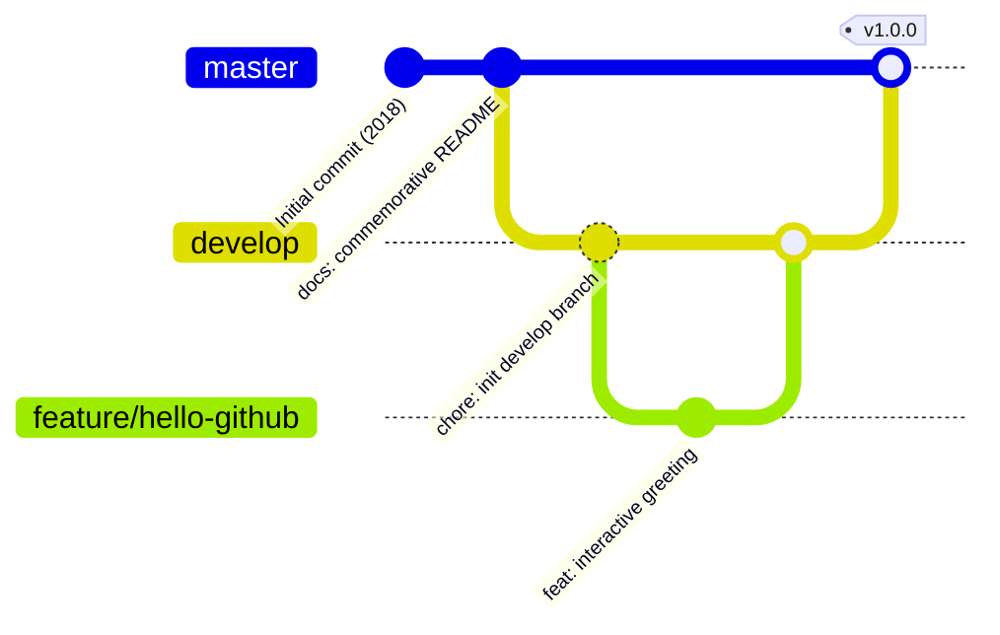

<div align="center">

# 🔥 fire

### *“Every flame begins with a single spark.”*

**The Genesis Repository of [@evanssamwel](https://github.com/evanssamwel) — Where the GitHub Journey Began.**

---

[](https://github.com/evanssamwel/fire)
[](https://github.com/evanssamwel/fire)
[](https://github.com/evanssamwel)
[](https://github.com/evanssamwel/fire/branches)
[](https://github.com/evanssamwel/fire)

---

</div>

## 🌟 Welcome to GitHub! (The Origin Story)

Eight years ago on **May 17, 2018**, I created this repository. 

I was testing GitHub for the very first time, figuring out what version control was, how commits worked, and exploring how developers worldwide collaborate on open-source code. Back then, this repository was born with just a single headline:

```markdown
# fire
```

No CI/CD pipelines, no automated tests, no complex microservices — just genuine curiosity and the thrill of seeing that first commit land on GitHub:

```bash
commit 95361d4d0a33cc1b5f39aa2c1f55cb8e1ae84431
Author: evanssamwel <39368748+evanssamwel@users.noreply.github.com>
Date:   Thu May 17 01:57:17 2018 -0700

    Initial commit
```

As part of polishing my repositories, this project stands as a tribute to humble beginnings. It is a reminder that every senior engineer was once a beginner learning what `git add` does.

---

## 🌿 Branch Architecture (Classic Gitflow)

To showcase how a developer progresses from a single-commit repo to understanding industry-standard workflows, this repository is organized into **three classic branches**:



| Branch | Purpose | Description |
|---|---|---|
| **`master`** | 🏛️ Production / Monument | The stable, polished face of the repository holding the commemorative monument. |
| **`develop`** | 🛠️ Active Development | The integration branch where upcoming features, scripts, and documentation improvements live. |
| **`feature/hello-github`** | ✨ Feature Showcase | A dedicated feature branch demonstrating how branching, isolated experiments, and PR workflows work. |

---

## 🚀 Experience the Spark

Run the commemorative script in your terminal to see the genesis banner:

```bash
python3 welcome.py
```

### Exploring the Branches

```bash
# Check all available branches
git branch -a

# Switch to the active development branch
git checkout develop

# Check out the feature branch
git checkout feature/hello-github
```

---

## 💡 The Beginner's Git Cheatsheet

A quick reference honoring the commands that every developer learns along the way:

```bash
# 1. Starting out
git init                             # Initialize a brand-new repository
git clone <url>                      # Bring down an existing project

# 2. Saving changes
git status                           # Check what has changed
git add .                            # Stage changes for commit
git commit -m "Your meaningful msg"  # Save staged snapshot

# 3. Branching like a pro
git branch                           # List local branches
git checkout -b <new-branch>         # Create and switch to a branch
git switch <branch-name>             # Switch between branches

# 4. Sharing with the world
git push origin <branch-name>        # Push your commits up to GitHub
git pull origin <branch-name>        # Fetch & integrate upstream changes
```

---

## ⏳ Then vs. Now (2018 ➔ Today)

| Milestone | May 2018 | Today |
|---|---|---|
| **First Git Command** | `git init` & wondering what `.git` is | Complete command over branching, rebasing, and CI/CD |
| **First Commit** | `# fire` | Clean commit messages, PRs, and semantic versioning |
| **Branching** | Solo `master` branch | Gitflow, trunk-based development & feature flags |
| **Perspective** | *"How does GitHub work?"* | *"What impactful project should we build next?"* |

---

## 💬 Reflection

> *"You don't have to be great to start, but you have to start to be great."*  
> — **Zig Ziglar**

This repository started as an empty slate named `fire`. That spark caught, grew, and became the foundation of everything that followed.

---

<div align="center">

Crafted with nostalgia & passion by **[Evans Samwel](https://github.com/evanssamwel)**  
*May 17, 2018 — Forever the first.*

</div>